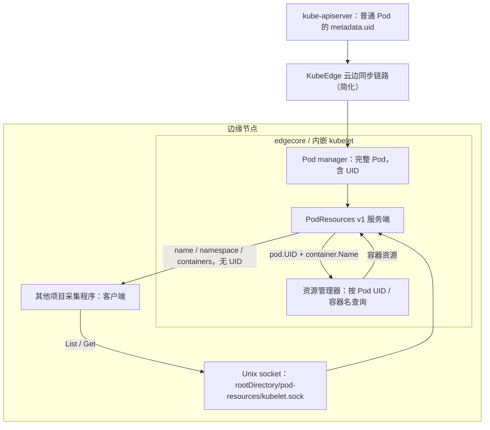
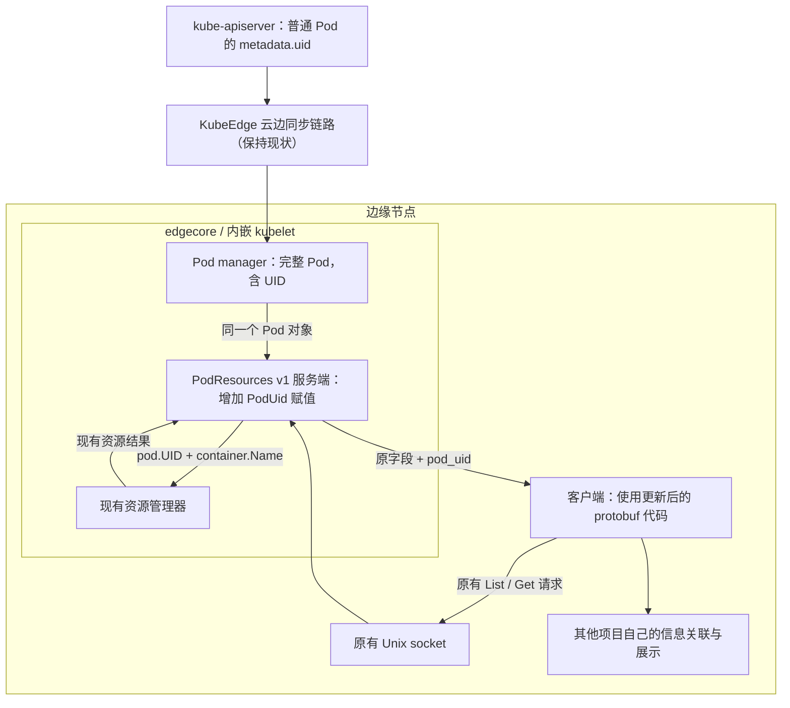

# PodResources 返回 Pod UID：实施计划

日期：2026-09-22。状态：方案待实施；本轮只核对源码并编写文档，未修改功能、未运行测试、未部署。

## 1. 目标与范围

在 edgecore 内嵌 kubelet 的 PodResources **v1** 响应中增加 `pod_uid`，直接返回 `string(pod.UID)`。其他项目自行获取节点、GPU 和 Pod 信息，并负责绑定关系与展示。

- 扩展 `List` 和 `Get` 共用的 `PodResources` 消息。
- 保留原有名称、命名空间、容器资源和查询语义。
- 复用现有 gRPC 服务和 Unix socket，不新增服务或端口。
- 不修改 cloudcore、kube-apiserver、GPU 查询与绑定逻辑。
- 本期不扩展 v1alpha1，不改变 `GetAllocatableResources`。

本方案属于标准 PodResources v1 协议的**私有扩展**，服务端与需要读取 UID 的客户端必须采用一致的扩展协议。不是上游 Kubernetes 已支持的能力。

## 2. 已核对事实

当前仓库通过 `go.mod` 将 Kubernetes 和 kubelet 模块替换为 KubeEdge fork 的 `v1.32.10-kubeedge1`。

### 2.1 仓库地址：现在用谁、需要 fork 谁

2026-09-22 本地 `git remote -v` 显示：`origin` 指向 `kubeedge/kubeedge`，`fork` 指向 `iKelvinLab/kubeedge`。用户随后确认已将 `kubeedge/kubernetes` fork 为 **`iKelvinLab/kubeedge-kubernetes`**；以下依赖地址按该实际仓库名称更新。fork 创建状态依据用户本轮确认，未独立验证远端内容或写权限。

| 用途 | 具体仓库地址 | 状态 / 本次作用 |
| --- | --- | --- |
| KubeEdge 主仓库 | https://github.com/kubeedge/kubeedge | 当前本地 `origin`；包含 edgecore 集成代码和依赖声明 |
| 你的 KubeEdge fork | https://github.com/iKelvinLab/kubeedge | 当前本地 `fork` 配置地址；用于交付 edgecore 依赖更新 |
| 当前实际依赖的 Kubernetes fork | https://github.com/kubeedge/kubernetes | `go.mod` 已引用；PodResources 服务端与协议代码都在这里 |
| 原生 Kubernetes 上游 | https://github.com/kubernetes/kubernetes | 对照与同步来源；本次基线应保留 KubeEdge fork 改动 |
| 你的 Kubernetes 依赖 fork | https://github.com/iKelvinLab/kubeedge-kubernetes | 用户确认已从 `kubeedge/kubernetes` 创建；用于修改 PodResources 协议与服务端 |

**需要 fork 的源仓库是 `kubeedge/kubernetes`。已有 `iKelvinLab/kubeedge` 不能替代它：一个承载 edgecore 集成，一个承载 kubelet 依赖源码。** GitHub 若因同一 fork 网络已有仓库而限制再次 fork，应复用已有 fork 并引入 KubeEdge 基线，实施前核对其内容。

用户已创建的个人依赖 fork 克隆地址：

```text
HTTPS: https://github.com/iKelvinLab/kubeedge-kubernetes.git
SSH:   git@github.com:iKelvinLab/kubeedge-kubernetes.git
```

仓库名称已确定为 `kubeedge-kubernetes`，不再使用先前推导的 `iKelvinLab/kubernetes`。创建 fork 不代表 Pod UID 改动已实现或发布；修改提交 SHA、模块版本及构建验证仍待实施。Go import 路径继续保留 `k8s.io/kubernetes` 和 `k8s.io/kubelet`，通过 replace 指向该 fork。

### 2.2 Go 模块地址与当前版本

仓库地址和 Go 模块路径不是同一层级：`kubelet` 是 Kubernetes 仓库内的 staging 子模块，不需要另外创建名为 kubelet 的仓库。

当前 `go.mod` 的相关 require：

```go
k8s.io/kubernetes v1.32.10
k8s.io/kubelet v0.32.10 // indirect
```

当前实际生效的 replace：

```go
k8s.io/kubernetes => github.com/kubeedge/kubernetes v1.32.10-kubeedge1
k8s.io/kubelet => github.com/kubeedge/kubernetes/staging/src/k8s.io/kubelet v1.32.10-kubeedge1
```

源码入口：

- [当前依赖版本的服务端](https://github.com/kubeedge/kubernetes/blob/v1.32.10-kubeedge1/pkg/kubelet/apis/podresources/server_v1.go)
- [当前依赖版本的协议](https://github.com/kubeedge/kubernetes/blob/v1.32.10-kubeedge1/staging/src/k8s.io/kubelet/pkg/apis/podresources/v1/api.proto)
- [当前依赖版本的生成代码](https://github.com/kubeedge/kubernetes/blob/v1.32.10-kubeedge1/staging/src/k8s.io/kubelet/pkg/apis/podresources/v1/api.pb.go)

这些源码链接按本地已声明版本构造，本轮未在线验证标签页面。

### 2.3 fork 后两端分别引用什么

在个人 fork 从 `v1.32.10-kubeedge1` 对应基线建立主题分支，例如 `podresources-pod-uid`，提交协议、生成代码、服务端实现及测试。完成后取得实际提交 SHA，再解析并锁定 Go 模块版本；不能仅 fork 后继续引用旧版本，否则不包含修改。

edgecore 所在 KubeEdge 主仓库需要同时替换两项：

```text
k8s.io/kubernetes => github.com/iKelvinLab/kubeedge-kubernetes <服务端模块版本>
k8s.io/kubelet => github.com/iKelvinLab/kubeedge-kubernetes/staging/src/k8s.io/kubelet <协议子模块版本>
```

其他项目的 PodResources 客户端至少替换协议模块：

```text
k8s.io/kubelet => github.com/iKelvinLab/kubeedge-kubernetes/staging/src/k8s.io/kubelet <协议子模块版本>
```

以上为依赖映射示意，尖括号必须替换为真实版本，不能原样写入 `go.mod`。可按同一个实际提交 SHA 查询两个模块，再使用 Go 返回的完整版本；根模块与 staging 子模块的伪版本字符串未必相同，不能手工拼造。若使用 tag，需遵循子模块的目录前缀标签规则，不能假设根模块 tag 自动发布全部 staging 模块。

两端都保留 `k8s.io/kubelet/...` 的 Go import 路径。客户端通常不需要依赖整个 Kubernetes 根模块；若它已使用根模块内辅助代码，再按实际依赖核对。

其他 staging 依赖先保留现有 KubeEdge 版本，检查模块图、重复模块路径和本地 replace 关系后处理必要调整，不批量迁移无关依赖。最终交付需记录：个人 fork URL、基线 SHA、修改 SHA、两个解析后的模块版本、edgecore 与客户端使用版本。

| 位置 | 当前行为 |
| --- | --- |
| `go.mod` | 指向 `github.com/kubeedge/kubernetes` 及其 staging kubelet 模块 |
| `edge/pkg/edged/edged.go` | `DefaultRunLiteKubelet` 使用 fork 的 `kubeletserver.Run` |
| `vendor/k8s.io/kubernetes/pkg/kubelet/kubelet.go` | `ListenAndServePodResources` 将 Pod manager、资源管理器传给服务端 |
| `vendor/k8s.io/kubernetes/pkg/kubelet/server/server.go` | 注册现有 v1 / v1alpha1 PodResources 服务 |
| `vendor/k8s.io/kubelet/pkg/apis/podresources/v1/api.proto` | `PodResources` 只有 name、namespace、containers |
| `vendor/k8s.io/kubernetes/pkg/kubelet/apis/podresources/server_v1.go` | `List` / `Get` 构造响应；资源查询已经使用 `pod.UID` |

普通 API 创建的 Pod，其 `metadata.uid` 由 kube-apiserver 生成。Pod 经云边同步后，kubelet 持有包含 UID 的 Pod 对象；无需新增 UID 生成或上报流程。

静态 Pod 属于特殊情况：直接返回 kubelet 本地 Pod 对象的 UID，不转换为 mirror Pod 的 UID。不能承诺它等于 apiserver 上 mirror Pod 的 `metadata.uid`。

上游调研依据：

- [Kubernetes release-1.32 PodResources v1 协议](https://raw.githubusercontent.com/kubernetes/kubernetes/release-1.32/staging/src/k8s.io/kubelet/pkg/apis/podresources/v1/api.proto)
- [Kubernetes master PodResources v1 协议](https://raw.githubusercontent.com/kubernetes/kubernetes/master/staging/src/k8s.io/kubelet/pkg/apis/podresources/v1/api.proto)

本轮查到的两个版本均无 Pod UID 字段；master 已使用 PodResources 字段编号 4、5 表示 Pod 级 CPU、内存。分支链接会变化，实施时应记录核对的具体 commit。

## 3. 当前架构

“服务端”是 edgecore 内嵌 kubelet 的 PodResources gRPC 服务；“客户端”是其他项目中连接该 socket 的采集程序，与云端/边缘端的划分无关。



socket 路径由 kubelet `rootDirectory` 决定，不能假设现场一定为 `/var/lib/kubelet`。容器内客户端应使用实际挂载后的路径。

## 4. 修改后的架构



服务端从查询资源时使用的同一 Pod 对象读取 UID，避免客户端按 `namespace/name` 二次查询导致同名重建串绑。该改动不增加跨资源管理器的事务快照保证，也不改变资源结果的时效性。

## 5. 协议设计

建议采用 `pod_uid` 字段名。以下暂用 **100** 作为私有字段编号候选；实施前必须检查实际 fork、客户端及目标上游版本不存在占用。高编号不是官方保留区，未来升级仍需核对冲突。

```protobuf
message PodResources {
    string name = 1;
    string namespace = 2;
    repeated ContainerResources containers = 3;

    // UID of the kubelet Pod object used to resolve these resources.
    string pod_uid = 100;
}
```

字段编号一旦随产品发布应保持稳定；不能随意更换编号或复用为其他语义。预计 Go 生成字段为 `PodUid`，访问方法为 `GetPodUid()`，最终以生成结果为准。

兼容行为：

| 服务端 | 客户端 | 预期 |
| --- | --- | --- |
| 旧版 | 旧版 | 行为不变 |
| 新版 | 旧版 | 标准 protobuf 客户端忽略未知字段；仍只能读取原字段 |
| 旧版 | 新版 | `GetPodUid()` 返回空字符串 |
| 新版 | 新版 | 可读取 UID；原字段保持不变 |

这些行为需要实际编码/解码回归验证。客户端严格依赖 UID 时，应将空 UID 标记为本次数据不满足要求，不得用名称、随机 UUID 或缓存中的旧 UID 代替。空字符串本身无法区分旧服务端与异常的空 UID 数据。

`Get` 仍受当前版本的 `KubeletPodResourcesGet` feature gate 控制；此需求不自动开启它。`List` 足以支持批量读取 UID。

## 6. 服务端代码逻辑

下面为补丁逻辑示意，不是已经完成的实现。

### List

在现有循环内增加一个字段，容器遍历、sidecar/init container 处理和资源查询保持现有逻辑：

```go
for i, pod := range pods {
    pRes := podresourcesv1.PodResources{
        Name:       pod.Name,
        Namespace:  pod.Namespace,
        PodUid:     string(pod.UID), // New field.
        Containers: make([]*podresourcesv1.ContainerResources, 0, len(pod.Spec.Containers)),
    }

    // Existing container traversal and resource collection remain here.
    // getContainerResources already queries providers using pod.UID.
    podResources[i] = &pRes
}
```

### Get

按请求中的 namespace/name 找到 Pod 后，用找到的对象填充 UID：

```go
pod, exist := p.podsProvider.GetPodByName(req.PodNamespace, req.PodName)
if !exist {
    // Preserve the existing not-found error and metrics behavior.
}

podResources := &podresourcesv1.PodResources{
    Name:       pod.Name,
    Namespace:  pod.Namespace,
    PodUid:     string(pod.UID), // New field.
    Containers: make([]*podresourcesv1.ContainerResources, 0, len(pod.Spec.Containers)),
}
// Continue with existing resource collection and response construction.
```

修改归属：

- fork 中 `staging/src/k8s.io/kubelet/pkg/apis/podresources/v1/api.proto`。
- 同目录生成的 `api.pb.go`，包含字段、getter、序列化/反序列化、大小计算、描述符等。
- fork 中 `pkg/kubelet/apis/podresources/server_v1.go` 及相应回归测试。
- KubeEdge 主仓库更新 `go.mod`、必要的 `go.sum` 和 vendor 内容。

正式交付应先落地 fork，再更新依赖。不能只手改生成的 Go struct，也不能只修改 vendor 后把依赖指向旧版本。

## 7. 客户端代码使用逻辑

客户端只需更新协议依赖，继续调用现有 socket 和方法。Go import 路径可保持 `k8s.io/kubelet/pkg/apis/podresources/v1`，但解析到的模块必须是包含新字段的 fork 版本。

依赖选择示意，尖括号内容须替换为实际发布版本：

```text
replace k8s.io/kubelet => github.com/iKelvinLab/kubeedge-kubernetes/staging/src/k8s.io/kubelet <包含 pod_uid 的协议子模块版本>
```

不要仅为获取一个客户端辅助函数引入整个 `k8s.io/kubernetes`；可复用其他项目已有的 gRPC 连接逻辑。以下函数假设调用方已建立到本机 socket 的连接，且已采用更新后的协议：

```go
package collector

import (
    "context"
    "fmt"
    "time"

    "google.golang.org/grpc"
    podresourcesv1 "k8s.io/kubelet/pkg/apis/podresources/v1"
)

func ListWithUID(
    ctx context.Context,
    conn *grpc.ClientConn,
) ([]*podresourcesv1.PodResources, error) {
    ctx, cancel := context.WithTimeout(ctx, 5*time.Second)
    defer cancel()

    client := podresourcesv1.NewPodResourcesListerClient(conn)
    resp, err := client.List(ctx, &podresourcesv1.ListPodResourcesRequest{})
    if err != nil {
        return nil, fmt.Errorf("list pod resources: %w", err)
    }

    for _, pod := range resp.GetPodResources() {
        if pod.GetPodUid() == "" {
            return nil, fmt.Errorf(
                "pod UID unavailable for %s/%s",
                pod.GetNamespace(), pod.GetName(),
            )
        }
    }
    return resp.GetPodResources(), nil
}
```

调用方通过 `pod.GetPodUid()` 读取身份，通过 `pod.GetContainers()` 继续读取现有数据。示例采用整批失败策略；其他项目可改为跳过缺少 UID 的单条记录并上报异常，但不能把缺失记录当作有效绑定。

如已有客户端使用 `Get`，读取方式相同：

```go
resp, err := client.Get(ctx, &podresourcesv1.GetPodResourcesRequest{
    PodName:      podName,
    PodNamespace: namespace,
})
if err != nil {
    return err
}
uid := resp.GetPodResources().GetPodUid()
if uid == "" {
    return fmt.Errorf("pod UID unavailable for %s/%s", namespace, podName)
}
```

连接须复用并由创建方关闭，RPC 设置超时。客户端如运行在容器内，沿用既有 socket 挂载与访问权限。上述代码用于说明新增字段的读取，不包含 GPU 绑定业务，也未在其他项目中编译验证。

## 8. 任务执行顺序

| 阶段 | 任务 | 交付 / 完成条件 |
| --- | --- | --- |
| 1. 确认基线 | 核对实际 edgecore 版本、fork 基线、客户端语言与协议版本；记录 socket 配置 | 服务端与客户端基线明确，确认客户端使用 v1 |
| 2. 固定协议 | 检查字段占用，确定 `pod_uid` 的最终编号与空值语义 | 两端共享同一份协议定义与字段编号 |
| 3. 更新 fork | 修改 proto；按 fork 的工具链重新生成代码；List/Get 填充 UID | fork 源码、生成文件、测试一致 |
| 4. 服务端验证 | 运行 PodResources 定向测试与序列化兼容测试 | UID 正确，现有资源结果和 gate 行为不变 |
| 5. 更新 edgecore | 引用包含改动的 fork 版本，同步 vendor，构建 edgecore | 可追溯的依赖版本与构建产物 |
| 6. 更新客户端 | 引用新协议，读取 UID，处理缺失字段 | 正常读取；旧服务端场景不产生伪造绑定 |
| 7. 集成验收 | 在测试节点调用 socket，核对普通 Pod UID，验证同名重建 | UID 与目标 Pod 对象对应，旧 UID 不归到新 Pod |
| 8. 发布交接 | 记录协议版本、字段编号、服务端/客户端版本及回滚方式 | 可逐步部署、可定位版本不匹配 |

fork 协议文件注明生成入口为 `hack/update-codegen.sh protobindings`；该命令须在对应 Kubernetes fork 中检查并执行，不能误用 KubeEdge 主仓库同名脚本。生成工具、Go 版本和完整检查以实际目标分支为准。

fork 中定向测试命令候选：

```sh
rtk go test ./pkg/kubelet/apis/podresources
```

完整 CI、生成校验及 edgecore 构建命令在实施时按目标分支 Makefile / CI 核对。仅跑定向测试不能表述为全量验证通过。

## 9. 验收用例

1. **List 返回 UID**：构造不同名称、命名空间和 UID 的 Pod，逐条断言 `PodUid == string(pod.UID)`。
2. **Get 返回 UID**：开启相应 gate 后断言返回 UID；关闭 gate、Pod 不存在时保留原有错误行为。
3. **查询身份一致**：mock 资源 provider，确认资源查询参数 UID 等于响应 UID。
4. **同名重建**：先观测 UID A 的 Pod，移除后加入同 namespace/name、UID B 的 Pod；新响应必须为 B，资源查询也使用 B。
5. **字段兼容**：新消息经序列化后由旧客户端读取原字段；旧消息由新客户端读取时 UID 为空。若 Go protobuf 类型注册冲突，使用独立测试进程或固定 wire fixture，避免两套同名协议注册到同一进程。
6. **原行为保留**：现有 CPU、内存、设备、容器及可重启 init container 测试继续通过。
7. **真实 socket 验收**：普通 Pod 的返回 UID 与该 Pod 对象 `metadata.uid` 一致；无需以真实 GPU 存在作为 UID 输出测试前提。
8. **静态 Pod 边界**：若实际使用静态 Pod，验证并记录返回本地 Pod UID，不将 mirror Pod UID 当作等价值。

## 10. 发布与回滚

推荐先更新服务端，再更新客户端。新服务端应兼容旧客户端；如果客户端先更新，必须处理 UID 为空的情况。

服务端回滚后，新客户端收到空 UID 时应停止相应有效绑定输出并报告缺失；已有数据如何失效由其他项目决定。协议字段将来与上游发生冲突时，须设计迁移，不能直接复用编号。

本计划不授权生产部署、重写已推送历史或合并 PR。当前交付仅为方案文档。
